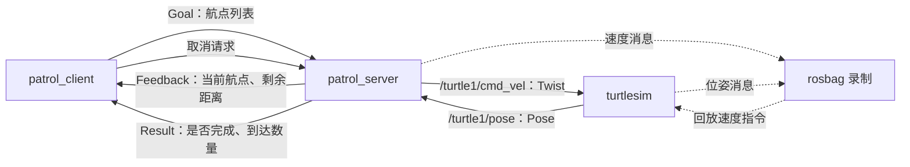

# ROS2 海龟巡逻系统

基于 **ROS 2 Humble、Python 和 turtlesim** 的独立学习项目：下发航点列表，按顺序巡逻，实时反馈进度，支持取消任务、参数配置、Launch 一键启动，以及 rosbag 数据录制与轨迹回放。

当前里程碑：**巡逻系统基础功能完成版**。已在学习环境中完成三航点巡逻、取消、参数调整、快慢模式和录制回放的基本验收。代码面向 turtlesim，未适配真实机器人底盘。

## 从新终端开始：完整演示启动命令

本节对应作者现有的学习容器，可直接用于展示**已经实现的基础系统**。
四个挑战加分项目前均未实现，不能用以下基础演示冒充挑战验收。
外部克隆仓库的使用者请按第5.2节准备原生 ROS2 环境；本仓库不包含课程镜像。

### 演示终端A：进入容器、构建、快速巡逻

在电脑上**新开一个主机终端**，执行：

```bash
cd '/home/cisyam/文档/ChatGPT/ROS2实战'
bash ros2_learning.sh enter
```

看到 `[ROS2实战]` 后，在**同一个终端**继续：

```bash
source /opt/ros/humble/setup.bash
cd /learning/patrol_project/ros2_ws
colcon build --symlink-install --packages-up-to patrol_robot
source install/setup.bash
```

先检查有没有以前的模拟器、服务端或客户端：

```bash
ps -eo pid,ppid,args | grep -E '[p]atrol_server|[p]atrol_client|[t]urtlesim_node'
```

没有输出，再启动。若有旧节点，先到原终端按 Ctrl+C，等提示符回来后再检查；不要再启动第二套。

```bash
ros2 launch patrol_robot patrol.launch.py mode:=fast
```

此终端保持运行，不输入其他命令。现场展示时说明：只执行一条 Launch 命令，就自动启动海龟、服务端和客户端；海龟依次经过 `(2,2) → (8,2) → (8,8)`；终端实时显示当前航点和剩余距离。

最终应显示：

```text
任务结束：状态码=4，全部完成=True，已到达航点数=3
```

### 演示终端B：查看节点和运行参数

另开一个**主机终端**，不要把这些命令输入正在运行 Launch 的终端A：

```bash
cd '/home/cisyam/文档/ChatGPT/ROS2实战'
bash ros2_learning.sh enter
```

进入容器后，在终端B继续：

```bash
source /opt/ros/humble/setup.bash
source /learning/patrol_project/ros2_ws/install/setup.bash
ros2 node list
ros2 action info /patrol
ros2 param get /patrol_server linear_speed
ros2 param get /patrol_server angular_speed
```

正常应有一个巡逻 Action 服务端，快速模式两项速度参数均为 `1.0`。

### 对比慢速模式并结束演示

等快速模式完成，在**终端A**按一次 Ctrl+C，等所有节点退出、提示符回来，再执行：

```bash
ros2 launch patrol_robot patrol.launch.py mode:=slow
```

在**终端B**重新查询速度，两项应均为 `0.5`，并能观察到运动更慢。慢速三航点完成后，在终端A按 Ctrl+C，等待全部节点退出。

最后可在终端B检查：

```bash
ps -eo pid,ppid,args | grep -E '[p]atrol_server|[p]atrol_client|[t]urtlesim_node'
```

没有输出表示节点已停止；`exit` 只退出当前容器终端。录制回放的完整流程见第9节，独立客户端取消演示见第8节，不要与本次 Launch 进程混用。

## 目录

- [1. 项目目标与完成情况](#1-项目目标与完成情况)
- [2. 系统架构与接口](#2-系统架构与接口)
- [3. 导航与取消的实现原理](#3-导航与取消的实现原理)
- [4. 仓库结构](#4-仓库结构)
- [5. 环境准备与构建](#5-环境准备与构建)
- [6. Launch 一键启动](#6-launch-一键启动)
- [7. 分终端运行与参数配置](#7-分终端运行与参数配置)
- [8. 取消与异常输入测试](#8-取消与异常输入测试)
- [9. rosbag 录制与回放](#9-rosbag-录制与回放)
- [10. 验收记录](#10-验收记录)
- [11. 常见问题](#11-常见问题)
- [12. 当前限制与后续方向](#12-当前限制与后续方向)
- [13. 挑战加分项：待实现与分步计划](#13-挑战加分项待实现与分步计划)

## 1. 项目目标与完成情况

用海龟模拟一台执行仓库巡逻任务的小车，完成“任务下发 → 逐点导航 → 进度反馈 → 结果返回 → 数据复盘”的流程。重点学习 ROS2 的接口、话题、Action、参数、Launch 和 rosbag 如何协同工作。

| 需求 | 实现 | 基本验收 |
|---|---|---|
| R1 自定义巡逻接口 | `Patrol.action` 定义 Goal、Result、Feedback | 接口生成、显示及任务通信已验证 |
| R2 多航点服务端 | 转向、前进、到达判断、反馈、中途取消停车 | 三航点成功及取消已验证 |
| R3 独立客户端 | 自动下发航点、打印反馈、超时/Ctrl+C 请求取消 | 自动巡逻与取消已验证 |
| R4 参数配置 | 线速度、角速度、路线、取消超时 | 动态改速度、改变路线与超时已验证 |
| R5 Launch | 一条命令启动三个节点，提供 slow/fast 模式 | 两种模式均完成三航点巡逻 |
| R6 数据复盘 | 录制速度与位姿，重启海龟后回放速度 | bag 信息及轨迹重现已验证 |

这里的“已验证”指下文记录的基本实验，不代表所有异常情况或真实机器人场景已覆盖。

## 2. 系统架构与接口



### 2.1 节点与话题

| 名称 | 职责 |
|---|---|
| `/turtlesim` | 仿真海龟运动、绘制轨迹、发布位姿 |
| `/patrol_server` | 接受航点、计算控制指令、反馈进度和任务结果 |
| `/patrol_client` | 读取路线参数、发送巡逻任务、接收反馈、请求取消 |
| `/patrol` | 类型为 `patrol_interfaces/action/Patrol` 的 Action |
| `/turtle1/cmd_vel` | `geometry_msgs/msg/Twist`；使用 `linear.x`、`angular.z` |
| `/turtle1/pose` | `turtlesim/msg/Pose`；读取 `x`、`y`、`theta` |

### 2.2 Patrol.action

源码：[Patrol.action](ros2_ws/src/patrol_interfaces/action/Patrol.action)。

```text
geometry_msgs/Point[] waypoints
---
bool completed
int32 visited_count
---
int32 current_waypoint
float64 remaining_distance
```

- **Goal**：按数组顺序依次经过航点。海龟为二维运动，使用 x、y，z 不参与导航。
- **Result**：`completed` 表示整条路线是否完成；`visited_count` 只统计真正到达的航点。
- **Feedback**：`current_waypoint` 从 1 开始，`remaining_distance` 表示到当前目标的距离。
- Action 返回还包含状态码：`4` 为 SUCCEEDED，`5` 为 CANCELED，`6` 为 ABORTED。

`completed=False` 不一定是程序错误：主动取消、空路线或无效坐标，都可能使任务没有完整完成。应结合 Action 状态和日志判断。

## 3. 导航与取消的实现原理

### 3.1 根据实时位置计算目标方向

服务端订阅位姿，每 0.05 秒执行一次控制循环，即约 20 Hz：

```python
dx = target.x - pose.x
dy = target.y - pose.y
distance = math.hypot(dx, dy)
target_angle = math.atan2(dy, dx)
angle_error = target_angle - pose.theta
angle_error = math.atan2(math.sin(angle_error), math.cos(angle_error))
```

`atan2(sin(error), cos(error))` 把角度差归一化到约 `[-π, π]`，避免方向跨越 ±π 时绕远路旋转。距离使用 turtlesim 仿真坐标单位；角度使用弧度。

### 3.2 三种运动状态

| 状态 | 行为与转换 |
|---|---|
| `idle` | 没有活动目标，不主动发送运动速度 |
| `turn` | 原地转向；角度误差绝对值小于 0.03 rad 后进入 `drive` |
| `drive` | 前进并修正方向；误差大于 0.30 rad 时返回 `turn` |

距离小于 **0.10** 时判定到达，发送零速度，将完成数量加一，再处理下一个航点。日志保留两位小数，所以显示 `0.10` 时，实际值可能已经低于阈值。

前进速度取 `min(linear_speed, distance)`，因此接近目标会减速。转向速度根据 `2.0 * angle_error` 计算，再限制在 `[-angular_speed, angular_speed]`，接近对准时也会减慢。

### 3.3 启动就绪与非阻塞等待

服务端先等待第一条 `/turtle1/pose`，取得位置后才创建 `/patrol` Action 服务。客户端每秒检查服务是否就绪，就绪后发送任务。这解决了一键启动时“服务端已经出现，但位置还没收到”的竞争问题。

Action 执行回调通过 `await motion_future` 等待当前航点完成；订阅和定时器仍可继续处理事件。导航没有用 `time.sleep()` 阻塞循环，也没有假设 Launch 列表中的前一个节点已完全就绪。

### 3.4 取消与安全停车

服务端同意取消后，控制循环优先处理取消，先发布零速度，再唤醒执行回调。执行回调将任务标记为 CANCELED，返回实际到达数量，清理活动目标。

客户端支持两种取消入口：

- 从服务端接受任务开始计时，达到 `cancel_timeout` 后请求取消。
- 在独立运行的客户端终端按 Ctrl+C，先请求取消、继续处理 ROS 通信，等待最终结果后退出。

取消不是暂停。任务取消后不会自动恢复剩余路线，需要重新下发任务。客户端请求取消也不等于已经取消：以服务端回复、最终状态及停车现象共同判断。

## 4. 仓库结构

```text
ros2-turtle-patrol/
├── README.md
├── LICENSE
├── .gitignore
├── ros2_ws/
│   └── src/
│       ├── patrol_interfaces/          ament_cmake 接口包
│       │   ├── action/Patrol.action
│       │   ├── CMakeLists.txt
│       │   └── package.xml
│       └── patrol_robot/               ament_python 节点包
│           ├── launch/patrol.launch.py
│           ├── patrol_robot/
│           │   ├── patrol_server.py
│           │   └── patrol_client.py
│           ├── setup.py
│           └── package.xml
└── tools/learning-container/           原学习环境的会话清理脚本备份
```

`build/`、`install/`、日志、缓存和 `bags/` 均不提交 Git。`bags/patrol_run_01` 是本地验收数据，并未随仓库发布；可按第9节自行录制。

## 5. 环境准备与构建

### 5.1 推荐环境

- Ubuntu 22.04 / Linux。
- ROS 2 Humble、Python 3、Bash、colcon。
- 可显示 turtlesim 窗口的桌面环境。
- 主要依赖：`rclpy`、`geometry_msgs`、`turtlesim`、`action_msgs`、`rosidl_default_generators`、`launch`、`launch_ros`。
- 录制回放需要 rosbag2 和 SQLite3 存储插件。

服务端使用 Linux 的 `fcntl` 文件锁；当前环境脚本也依赖 Linux `/proc`。

### 5.2 原生 ROS2 环境：克隆与编译

以下命令用于**已安装 ROS2 Humble 的原生 Linux 终端**。先按需安装学习工具和 rosbag：

```bash
sudo apt update
sudo apt install ros-humble-turtlesim python3-colcon-common-extensions \
  ros-humble-rosbag2 ros-humble-rosbag2-storage-default-plugins
```

克隆并进入工作空间：

```bash
cd ~
git clone https://github.com/cisyam555/ros2-turtle-patrol.git
cd ~/ros2-turtle-patrol/ros2_ws
source /opt/ros/humble/setup.bash
```

如果已经配置 rosdep，可安装工作空间声明的依赖：

```bash
rosdep install --from-paths src --ignore-src -r -y --rosdistro humble
```

构建并检查：

```bash
colcon build --symlink-install --packages-up-to patrol_robot
source install/setup.bash
ros2 interface show patrol_interfaces/action/Patrol
ros2 pkg executables patrol_robot
ros2 launch patrol_robot patrol.launch.py --show-args
```

应看到 `patrol_server`、`patrol_client` 两个启动入口，以及默认值为 `slow` 的 `mode` Launch 参数。

### 5.3 原学习容器：进入与编译

**主机终端**执行：

```bash
cd '/home/cisyam/文档/ChatGPT/ROS2实战'
bash ros2_learning.sh enter
```

看到 `[ROS2实战]` 后，才是**容器终端**，在其中执行：

```bash
source /opt/ros/humble/setup.bash
cd /learning/patrol_project/ros2_ws
colcon build --symlink-install --packages-up-to patrol_robot
source install/setup.bash
```

路径对应关系：

| 环境 | 独立项目工作空间 |
|---|---|
| 当前主机 | `/home/cisyam/文档/ChatGPT/ROS2实战/patrol_project/ros2_ws` |
| 学习容器 | `/learning/patrol_project/ros2_ws` |
| 原生克隆示例 | `~/ros2-turtle-patrol/ros2_ws` |

`/learning` 是容器挂载路径，不能直接在主机终端中 `cd /learning/...`。容器入口和本地镜像不是 ROS2 包的一部分；脚本备份与部署说明见 [tools/learning-container/README.md](tools/learning-container/README.md)。仓库未发布预构建的课程镜像，外部使用者可按5.2节使用原生环境。

### 5.4 每个新终端都要加载环境

每个新的 ROS 终端先加载系统环境，再加载本项目构建结果。原生示例：

```bash
source /opt/ros/humble/setup.bash
source ~/ros2-turtle-patrol/ros2_ws/install/setup.bash
```

容器对应为：

```bash
source /opt/ros/humble/setup.bash
source /learning/patrol_project/ros2_ws/install/setup.bash
```

所有节点必须使用同一 ROS 通信域。学习容器自动使用 `ROS_DOMAIN_ID=43`；不要让其中一个终端使用不同的域。

## 6. Launch 一键启动

确保没有另一套海龟或巡逻节点运行。加载环境后，只需一个终端：

```bash
ros2 launch patrol_robot patrol.launch.py
```

默认慢速，也可以显式指定：

```bash
ros2 launch patrol_robot patrol.launch.py mode:=slow
```

快速模式：

```bash
ros2 launch patrol_robot patrol.launch.py mode:=fast
```

| Launch 模式 | 线速度上限 | 角速度上限 |
|---|---:|---:|
| `slow`（默认） | 0.5 | 0.5 |
| `fast` | 1.0 | 1.0 |

Launch 同时启动 turtlesim、服务端和客户端。当前 Launch 文件给客户端传入固定路线 `(2,2) → (8,2) → (8,8)`，并把超时设为 **120秒**。正常完成后：

```text
[patrol_server]: 全部航点巡逻完成
[patrol_client]: 任务结束：状态码=4，全部完成=True，已到达航点数=3
```

任务完成后终端继续运行是正常的，节点仍由 Launch 管理。按 Ctrl+C 可以关闭整套系统，等待各进程退出、命令提示符回来后再关闭终端。

当前 Launch 只暴露 `mode` 启动参数，不能把 `waypoints:=...` 或 `cancel_timeout:=...` 直接当作现成的 Launch 参数使用。自定义路线可按第7节独立启动客户端，或修改 Launch 文件中的节点参数配置。

> 测试客户端 Ctrl+C 取消时，请采用分终端运行。对 Launch 终端按 Ctrl+C 会同时关闭服务端和模拟器，不能据此保证客户端收到完整的取消确认。

## 7. 分终端运行与参数配置

以下三个终端均先按5.4节加载环境。不要与一键启动的系统同时运行。

### 7.1 终端1：海龟模拟器

```bash
ros2 run turtlesim turtlesim_node
```

保持运行。

### 7.2 终端2：巡逻服务端

```bash
ros2 run patrol_robot patrol_server --ros-args \
  -p linear_speed:=0.5 -p angular_speed:=0.5
```

保持运行。第一次收到位姿后应打印“巡逻服务已就绪，等待任务”。

### 7.3 终端3：巡逻客户端

使用默认三航点、120秒超时：

```bash
ros2 run patrol_robot patrol_client --ros-args -p cancel_timeout:=120.0
```

不改源码，换成两个航点：

```bash
ros2 run patrol_robot patrol_client --ros-args \
  -p cancel_timeout:=120.0 \
  -p 'waypoints:=[3.0, 3.0, 7.0, 3.0]'
```

这里每两个数表示一个 x、y，即 `(3,3) → (7,3)`。数组必须非空且长度为偶数，数值使用 `3.0` 这样的浮点数形式。服务端进一步检查 x、y 是否有限且在 `[0.5,10.5]` 内。进度总数自动跟随配置的航点数变化。

客户端每次启动自动发送一次任务。任务成功或超时取消后，客户端仍运行，按 Ctrl+C 退出；再次启动才会再发任务。

### 7.4 参数默认值与生效时机

| 所属节点 | 参数 | 节点代码默认值 | 生效方式 |
|---|---|---|---|
| `/patrol_server` | `linear_speed` | `1.0` | 控制循环读取，可在运行中修改 |
| `/patrol_server` | `angular_speed` | `1.0` | 控制循环读取，可在运行中修改 |
| `/patrol_client` | `cancel_timeout` | `10.0` 秒 | 接受任务后读取一次，用于创建本次定时器 |
| `/patrol_client` | `waypoints` | `[2.0,2.0,8.0,2.0,8.0,8.0]` | 发送任务时读取一次 |

**单独启动客户端默认超时为10秒；Launch 将其覆盖为120秒。** 直接运行客户端而没有加参数时，可能在整条路线完成前被正常取消。

只使用正的、有限的速度上限和超时时间。当前未实现完整的参数值校验回调；不要用零、负数、NaN 或无穷值测试真实运动效果。

修改运行中的 `waypoints` 不会改变已经下发的 Goal；修改 `cancel_timeout` 不会重建已经运行的定时器。这两项建议通过启动参数配置。

### 7.5 终端4：运动中调整速度

在空闲终端加载 ROS 环境后：

```bash
ros2 param get /patrol_server linear_speed
ros2 param set /patrol_server linear_speed 0.5
ros2 param set /patrol_server linear_speed 1.0
ros2 param get /patrol_server angular_speed
ros2 param set /patrol_server angular_speed 0.5
ros2 param set /patrol_server angular_speed 1.0
```

参数修改成功显示 `Set parameter successful`。距离目标较远时比较直行速度；方向偏差较大时比较转向速度。接近目标或方向对准时，控制器主动减速，不一定达到参数上限。

通过 `ros2 param set` 的修改仅对当前节点进程有效，重启后恢复代码默认值或启动命令提供的值。

## 8. 取消与异常输入测试

### 8.1 超时自动取消

使用分终端运行，前一轮任务结束后，在终端3启动：

```bash
ros2 run patrol_robot patrol_client --ros-args -p cancel_timeout:=10.0
```

服务端接受任务后约10秒应显示：

```text
已达到任务超时时间，请求取消巡逻
服务端已同意取消，等待最终结果
任务结束：状态码=5，全部完成=False，已到达航点数=...
```

同时观察海龟停止前进和转动。已到达数量取决于初始位置和速度，不固定为1。任务若先成功，客户端会取消定时器，不再额外请求取消。

### 8.2 客户端 Ctrl+C 取消

独立运行客户端，使用较长超时；看到“服务端已接受任务”且海龟运动时，在**客户端终端**按一次 Ctrl+C，等待取消结果和命令提示符。海龟、服务端终端保持运行。

客户端退出前最多等待接单回复5秒、任务最终结果5秒。若超时，日志会提示状态未确认，不能把客户端退出视为已收到取消确认。

### 8.3 用命令行代替客户端

不运行 Python 客户端时，也可以直接下发 Goal：

```bash
ros2 action send_goal /patrol patrol_interfaces/action/Patrol \
  "{waypoints: [{x: 2.0, y: 2.0, z: 0.0}, {x: 8.0, y: 2.0, z: 0.0}, {x: 8.0, y: 8.0, z: 0.0}]}" \
  --feedback
```

CLI 被占用时，另开一个已加载环境的终端取消：

```bash
ros2 service call /patrol/_action/cancel_goal action_msgs/srv/CancelGoal '{}'
```

空请求表示取消该 Action 中可取消的全部任务；本项目正常只运行一个巡逻任务。**对 `ros2 action send_goal` 命令按 Ctrl+C，不等于向服务端发送取消请求。**

### 8.4 输入检查

- 客户端收到奇数个坐标会记录错误，不发送 Goal。示例：`-p 'waypoints:=[2.0, 2.0, 8.0]'`。
- 服务端对空 Goal、非有限坐标、越界坐标返回 ABORTED，并记录原因。
- 忙碌时，新任务目前会先被 Action 接受，再在执行回调中中止；尚未实现抢占或排队。

异常测试前先结束正常任务，避免把忙碌中止和输入校验混淆。以上列出了代码行为，尚未对所有异常组合完成自动化覆盖。

## 9. rosbag 录制与回放

### 9.1 录什么、为什么录

| 话题 | 录制目的 |
|---|---|
| `/turtle1/cmd_vel` | 保存带时间顺序的运动指令，用于重新驱动海龟 |
| `/turtle1/pose` | 保存实际位姿，用于离线查看轨迹和分析运动结果 |

位姿消息只是状态数据；仅回放 pose 不能驱动海龟画出运动轨迹。海龟移动依赖 cmd_vel，或者另行使用设置位姿的服务。

以下用**学习容器路径**演示。原生环境将 `/learning/patrol_project` 换为实际仓库路径即可。每个新终端按5.4节加载环境。开始前先停止旧巡逻系统，避免多个模拟器或多个控制节点。

### 9.2 录制终端：先开录制

```bash
mkdir -p /learning/patrol_project/bags
ros2 bag record -o /learning/patrol_project/bags/patrol_run_01 \
  /turtle1/cmd_vel /turtle1/pose
```

看到 `Listening for topics...`、`Recording...` 后保持运行。此时还没有海龟也可以等待。输出目录必须是新的；已经存在时改用 `patrol_run_02` 等名字，不要覆盖旧记录。

### 9.3 巡逻终端：再启动一轮完整任务

```bash
ros2 launch patrol_robot patrol.launch.py mode:=fast
```

等客户端返回状态码4、`全部完成=True`、到达数量3，确认海龟停车后，回到**录制终端**按 Ctrl+C。等 `Recording stopped` 和命令提示符出现，确保缓存已经写入。

顺序是：**先录制 → 再启动巡逻 → 完成停车 → 停止录制**，避免漏掉开头的指令或结尾的零速度。

### 9.4 检查 bag

在停止录制的终端执行：

```bash
ros2 bag info /learning/patrol_project/bags/patrol_run_01
```

本次学习验收数据：

| 项目 | 结果 |
|---|---:|
| 存储格式 | sqlite3 |
| 文件 | `patrol_run_01_0.db3` |
| Bag 大小 | 229.4 KiB |
| 消息时间跨度 | 39.855670594秒 |
| 总消息数 | 3089 |
| `/turtle1/cmd_vel` | 597 |
| `/turtle1/pose` | 2492 |

位姿发布持续进行，停车后仍发布；速度主要在运动控制时发送，因此两种消息数不同。bag 的消息时间跨度也不一定包含录制器启动后等待话题的空白时间。

### 9.5 停止原控制节点，只启动新海龟

在**巡逻终端**对 Launch 按 Ctrl+C，等待三个节点退出。然后在同一个终端只启动模拟器：

```bash
ros2 run turtlesim turtlesim_node
```

新海龟默认初始位置约为 `(5.5444, 5.5444)`，朝向为0，匹配本次录制时的初始状态。保持模拟器运行，**不要启动巡逻服务端或客户端**。

若录制时使用了不同初始位置或朝向，回放前也应恢复相同状态，否则同一组速度指令会得到不同轨迹。

### 9.6 在录制终端回放速度

```bash
ros2 bag play /learning/patrol_project/bags/patrol_run_01 \
  --topics /turtle1/cmd_vel
```

应再次看到海龟依次走向 `(2,2) → (8,2) → (8,8)`，最后停车。此次实际操作中已观察到轨迹重现。

只回放 cmd_vel 是为了让新模拟器根据指令产生自己的位姿，避免把旧 pose 和实时 pose 混在同一话题里。原始 pose 仍保留在 bag 内供分析。

这是按记录指令进行的开环重演，不会根据新位姿纠偏。DDS 发现、调度和仿真执行时序可能带来误差，因此“视觉重现”不等于逐点完全一致或精确坐标复现。回放结束返回提示符正常；仅看到“成功打开数据库”还不能证明海龟已运动。

## 10. 验收记录

下表记录学习过程中实际完成的验证，不把文档准备或模板测试当作功能验收。

| 验证项目 | 已观察到的结果 |
|---|---|
| 多航点导航 | 三个航点依次完成，`SUCCEEDED`，完成数3 |
| 速度参数 | 0.5与1.0查询正确，运行中直行/转向快慢可见 |
| 路线参数 | 配置 `(3,3) → (7,3)`，反馈总数2，最终完成数2 |
| 超时参数 | 设置30秒执行，第二航点途中取消，最终状态5、完成数1 |
| Launch 快速模式 | 线速度和角速度均为1.0，三航点完成 |
| Launch 慢速模式 | 线速度和角速度均为0.5，明显更慢，三航点完成 |
| bag 录制 | 第9节所列两话题，消息总数3089 |
| bag 回放 | 停止原控制节点、重启海龟后，速度回放重现轨迹 |
| 取消集成测试 | 隔离通信域内发送 SIGINT，收到 CANCELED、零速度及正常退出 |
| 终端生命周期 | PTY 测试客户端 Ctrl+C、服务端 Ctrl+C、关闭服务端终端，无节点/僵尸残留 |

另有两包构建、Python 语法/导入、Launch 参数解析和 Shell 语法检查。全套现场巡逻与回放主要由人工验证；仓库尚未提供覆盖全部功能的自动化测试套件。

## 11. 常见问题

### 主机提示 `/learning/...` 或 `/opt/ros/humble/...` 不存在

先判断环境。学习容器路径应在 `bash ros2_learning.sh enter` 后使用；主机提示符和 `[ROS2实战]` 提示符不是同一环境。原生环境则使用实际克隆目录。

### `Waiting for an action server to become available...`

先确认海龟、服务端均在运行。当前服务端收到第一条位姿后才开放 Action。检查：

```bash
ros2 node list
ros2 topic info /turtle1/pose
ros2 action info /patrol
```

还要检查各终端是否使用同一通信域。只启动客户端或发送 CLI Goal，海龟不会自行执行任务。

### `ros2 param set` 提示 `Node not found`

巡逻服务端未运行、已经退出，或当前终端在其他 ROS 通信域。先恢复服务端再调参。

### 出现两个 `/patrol_server`

先停止重复实例，不要让两套程序同时发速度。检查：

```bash
ps -eo pid,ppid,args | grep '[p]atrol_server'
ros2 action info /patrol
```

启动器和节点通常各占一行，两行进程不一定是两个实例；Action 正常应只有一个服务端。Linux 文件锁限制同一用户、同一通信域通过本入口启动的实例；不覆盖其他用户、容器或绕过入口的代码。

### 关闭终端后仍有进程或 `<defunct>`

直接 docker-exec 会话关闭主机窗口后，容器内节点可能继续运行。修复后的学习入口会管理所属会话并清理子进程，使用方式见 [环境脚本说明](tools/learning-container/README.md)。旧入口的会话不受新机制管理。

`<defunct>` 表示进程已退出、等待父进程回收，不能再靠 kill 清掉。旧容器 PID 1 留下的僵尸记录可能需要一次容器重启；活跃节点应先按正常退出流程停止。重启容器会中断其中运行的所有会话。

建议先在节点终端按 Ctrl+C，等提示符回来再关闭窗口。学习容器进入时的 `groups: cannot find name for group ID 992` 是该环境的组名提示，已验证不影响本项目运行。

### Launch 文件找不到

确认文件放在 `patrol_robot/launch`，`setup.py` 的 `data_files` 包含 Launch 安装项，并重新构建、加载环境：

```bash
colcon build --symlink-install --packages-up-to patrol_robot
source install/setup.bash
ls "$(ros2 pkg prefix patrol_robot)/share/patrol_robot/launch"
```

已有 Python 文件在 symlink-install 下通常保存后重启节点即可；修改接口、安装入口、包依赖或新增安装文件后应重新构建。

### 回放不动或路线不一致

确认新模拟器已启动且只有一个，初始位姿匹配；原控制节点已停止；bag 的 cmd_vel 消息数大于0；回放选择的是 cmd_vel 而不是仅 pose。检查录制是否包含完整任务，必要时从新初始状态重新录制。

## 12. 当前限制与后续方向

已完成课程六项核心要求的基本实现与验证。以下尚未实现或未完整验证：

- 暂停后继续、任务队列、多任务抢占、双龟巡逻、超时自动返航。
- 完整的参数值校验、位姿中断/过期检测、每航点独立导航超时。
- 把路线和超时进一步暴露为 Launch 参数；当前只暴露快慢模式。
- rosbag 位姿的自动数值轨迹对比与误差指标。
- 全功能自动化回归测试与持续集成；模板测试文件不代表检查已全部通过。
- 真实机器人所需的里程计、定位、障碍物检测、速度约束和急停机制。

当前程序收到位置后就使用最新缓存值，未监控其时效；不应把它直接部署成真实底盘的安全控制器。后续可按需要补齐异常处理和测试，再迁移到真实机器人或 Nav2 学习。

## 13. 挑战加分项：待实现与分步计划

以下是下一阶段开发目标，**目前均未完成，也未提供声称可以直接运行的拓展演示命令**。
每项完成后再补充真实启动命令、验证结果和 Git 提交。

| 建议顺序 | 挑战 | 当前缺口 | 现场验收目标 |
|---|---|---|---|
| 1 | 双龟巡逻 | 话题固定 `/turtle1/...`；进程锁按用户和域限制单实例 | 生成第二只海龟，各自完成独立路线，互不控制错对象 |
| 2 | 多任务抢占 | 忙碌时中止的是新任务，旧任务继续 | 新任务到来后旧任务先终止并停车，新任务再开始 |
| 3 | 超时自动返航 | 只有整项任务的客户端取消，无单航点计时和返航 | 单航点超过30秒后停止巡逻并返回记录的起点 |
| 4 | 回放对比 | 仅完成单次视觉回放，无两轮数值对比工具 | 同配置录两轮，绘制轨迹并输出误差指标 |

建议先做双龟所需的“控制对象可配置”，因为之后抢占、返航和录制对比都可以复用清晰的话题与任务边界。
这不是一次把四项代码全部改完：每个小步骤仍先跑通单龟，再扩展验收。

详细拆分、预期改动文件、完成条件和需要处理的边界见 [拓展任务分步开发计划](docs/extension-plan.md)。

几点需要区分：

- 目前忙碌时 `abort()` **新任务**不叫抢占；抢占要求旧任务退出，并防止旧任务的清理代码把新任务也清掉。
- 多开第二个服务端之前，必须处理固定话题、Action 名称和单实例锁，不能只复制一条启动命令。
- turtlesim 的 `(0,0)` 靠近边界且不在当前航点有效范围内。返航应使用事先记录的任务起点，例如默认 `(5.54,5.54)`，并明确定义“回原点”。
- 仿真模型具有确定性，不表示两次 ROS 闭环运行按时间采样的轨迹必定逐点相同。需要统一初始位姿、参数、时间基准并进行插值对齐，再衡量差异；真实机器人还存在定位误差、打滑、传感器噪声和外部扰动。

## 许可证

代码采用 Apache-2.0，见 [LICENSE](LICENSE)。ROS2、turtlesim 等第三方组件遵循各自许可证。课程 Docker 镜像与本地录制数据未包含在仓库中。
